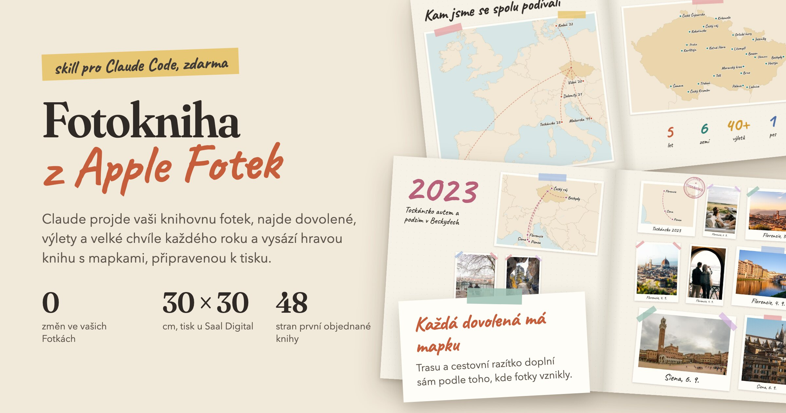
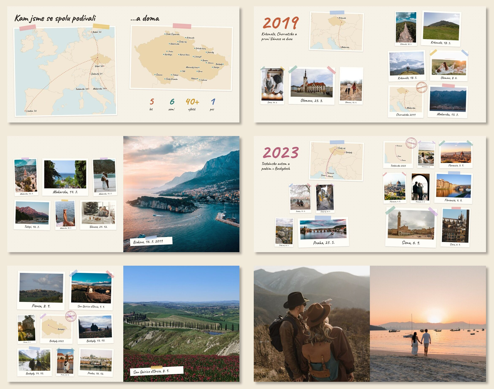

[English](README.md) · **Česky**

# Fotokniha z Apple Fotek: skill pro Claude Code



Claude projde celou vaši knihovnu Apple Fotek, najde dovolené, výlety a velké chvíle každého roku, pomůže vybrat
nejlepší fotky a vysází z nich **hravou fotoknihu**: polaroidy s washi páskou, ručně psané popisky, mapku ke každé
dovolené, cestovní razítka a úvodní mapu všech míst, kam jste se spolu podívali. Na konci připraví PDF, které
nahrajete do tiskárny.

Hodí se jako dárek: k Vánocům, výročí, narozeninám, „našich deset let“, první rok s miminkem. Technickou práci dělá
Claude. Vy víte, co se na fotkách děje, rozhodujete o výběru a schvalujete vzhled.

Vznikl při skutečné knize: 48 stran k Vánocům, vytištěné u Saal Digital v listopadu 2026.

## Jak kniha vypadá
Ukázka z vymyšlené knihy Jany a Petra, kterou skill vysázel z volných fotek z Pexels:



- **Titulní strana** se jmény, roky a fotkou.
- **Úvodní dvoustrana**: mapa světa s čárkovanými trasami z domova, mapa domova se srdíčky v místech, kde jste
  bydleli, a velká čísla (roky, země, výlety a cokoli vlastního, třeba „1 pes“).
- **Každý rok** začíná velkým barevným letopočtem, krátkým podtitulem a mapkou roku.
- **Fotky** jsou malé polaroidy s popiskem místa a data, nejvýš 8 na stranu.
- **Každá dovolená** má vlastní mapku: road trip s trasou a zastávkami, nebo „kde to je“ s cestou z domova.
  K tomu razítko jako v pasu.
- **Pár fotek přes celou stranu**, závěrečná dvojice přes dvoustranu a „Pokračování příště…“.

## Jak vybírá
- Důležité je to, co jste hodně fotili na jednom místě, i doma. Promoce, Vánoce nebo nové kotě jsou v knize,
  zastávka s pěti fotkami ne.
- Využívá, co už Fotky ví: kdo je na fotce, kde vznikla a jak ji Apple hodnotí (ostrost, kompozice, světlo).
- Pro každou kapitolu udělá kontaktní tabuli s očíslovanými kandidáty. Claude je prohlédne a vybere, vy výběr
  upravíte.
- Na co si nejde odpovědět z dat (byla to svatba, nebo promoce?), se zeptá.

## Soukromí
- **Knihovnu Fotek jen čte.** Nevytváří alba, nemění oblíbené ani jména. Nic se nesynchronizuje přes iCloud,
  takže se dá dělat i překvapení.
- Fotky ani náhledy nikam nenahrává. Všechno zůstává ve složce projektu na vašem Macu. Ven jdou jen tisková PDF,
  která do tiskárny nahrajete sami.
- Intimní fotky, doklady a screenshoty vynechává sám. Na další hranice se zeptá.

## Co budete potřebovat
- **Mac s aplikací Fotky.** Nejlíp funguje, když máte ve Fotkách pojmenované lidi (album Lidé a zvířata).
- **Claude Code** (aplikace nebo příkazová řádka) a předplatné Claude. Prohlížení stovek fotek spotřebuje dost
  kreditů, takže počítejte aspoň s tarifem Pro, u velké knihovny spíš Max.
- Programy **uv, ImageMagick a Google Chrome** (Chrome vykresluje strany). Claude zkontroluje, co chybí, a po vašem
  souhlasu je nainstaluje přes [Homebrew](https://brew.sh).
- Aplikace, ve které Claude běží (Terminál, Claude), potřebuje **Úplný přístup k disku**, aby mohla číst knihovnu
  Fotek. Najdete ho v Nastavení systému → Soukromí a zabezpečení.
- Místo na disku: asi 5 MB na každou fotku v knize a pár set MB na tisková data.

## Instalace

### Jako plugin (doporučeno)
V Claude Code napište:
```
/plugin marketplace add kosarlukascz/fotokniha-skill
/plugin install fotokniha@fotokniha-skill
```
Pak Claude Code restartujte.

### Ručně
Stáhněte repozitář (**Code → Download ZIP**, nebo `git clone`) a zkopírujte složku `skills/fotokniha`
do `~/.claude/skills/`. Výsledek: `~/.claude/skills/fotokniha/SKILL.md`. Pak Claude Code restartujte.

## První spuštění
Spusťte Claude Code a napište třeba:
> Chci udělat fotoknihu pro manželku k Vánocům, našich 10 let od roku 2015. Má to být překvapení.

nebo přímo `/fotokniha`. Claude založí složku projektu (např. `~/Fotokniha-Jana`), načte knihovnu a začne se ptát.
Příště otevírejte Claude Code v této složce, Claude naváže tam, kde jste skončili.

## Jak to probíhá
| Krok | Co děláte vy | Co dělá Claude |
|---|---|---|
| 1. Rozhovor | řeknete, pro koho kniha je, za jaké období a do kdy | založí projekt |
| 2. Knihovna | potvrdíte, kdo je kdo | načte metadata všech fotek (u 60 000 fotek asi minuta) |
| 3. Roky | potvrdíte, kde jste bydleli, a řeknete, co byly nejasné akce | najde dovolené, výlety a velké chvíle každého roku |
| 4. Výběr | díváte se a říkáte, co přidat nebo vyhodit | prohlédne kontaktní tabule a vybere nejlepší fotky |
| 5. Náhled | připomínkujete | vysází knihu a ukáže celou na jednom obrázku i po dvoustranách |
| 6. Tisk | objednáte | stáhne originály z iCloudu a připraví PDF přesně podle tiskárny |

Celé to zabere jeden až dva večery. Nejdéle trvá výběr fotek a ladění podle vás.

## Tisk
Připravené a vyzkoušené je to pro **Saal Digital Professional Line 30 × 30 cm** (layflat, nahrání PDF, akrylová
obálka). Pro jinou tiskárnu se čtvercovou knihou stačí zadat její rozměry. Claude je najde v její specifikaci
a nastaví (viz [reference/tisk.md](skills/fotokniha/reference/tisk.md)).

## Omezení
- Jen **macOS a Apple Fotky**. Fotky z Google Photos nebo z jiného telefonu je potřeba nejdřív naimportovat do Fotek.
- Rozvržení je **čtvercové**.
- Texty v knize jsou česky. Všechny nápisy se dají změnit v nastavení `kniha.json` (anglická ukázka je
  v [README.md](README.md)), data jsou v českém formátu (`16. 7.`).
- Výběr je jen tak dobrý jako vaše knihovna. Z let, kdy jste fotili málo nebo jen na jiný telefon, bude v knize méně.

## Co je uvnitř
```
skills/fotokniha/
  SKILL.md              postup pro Clauda
  tools/                nástroje v Pythonu (čtení knihovny, cesty, události, výběr, sazba, tisk)
  reference/            nastavení knihy a tisk
  template/             šablona nastavení kniha.json
  assets/               písmo Caveat
```
Nástroje jdou spustit i bez Clauda (`python3 tools/<nástroj>.py --help`). Ke čtení knihovny používají
[osxphotos](https://github.com/RhetTbull/osxphotos), mapy jsou z [Natural Earth](https://www.naturalearthdata.com)
(volné dílo, stáhnou se při prvním použití) a písmo je [Caveat](https://github.com/googlefonts/caveat)
(SIL Open Font License). Fotky v ukázce jsou z [Pexels](https://www.pexels.com/license/), autoři jsou uvedení
v [docs/photo-credits.md](docs/photo-credits.md).

## Licence
MIT, viz [LICENSE](LICENSE).
