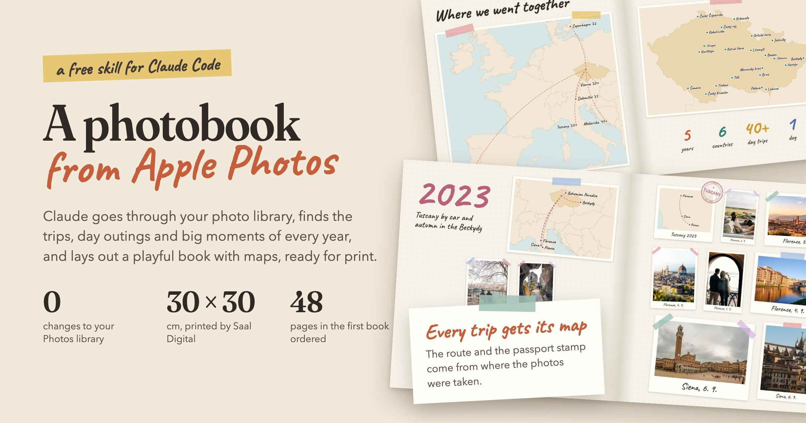
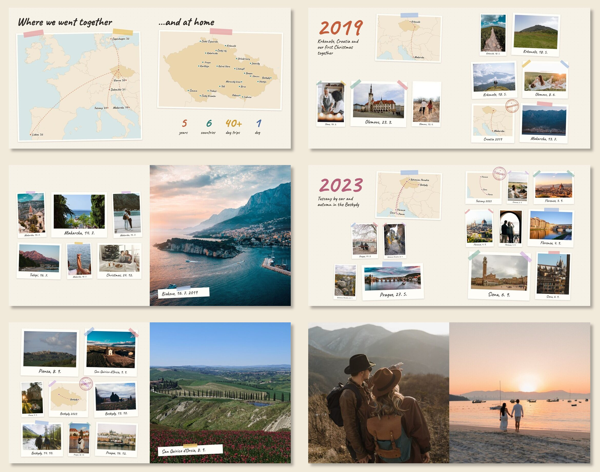

**English** · [Česky](README.cs.md)

# Fotokniha: a photobook from Apple Photos, made with Claude Code



Claude goes through your whole Apple Photos library, finds the trips, day outings and big moments of every year,
helps you pick the best photos and lays them out as a **playful photobook**: polaroids with washi tape, handwritten
captions, a map for every trip, passport stamps and an opening map of everywhere you have been together. At the end
it prepares the PDFs you upload to the printer.

It makes a good gift: for Christmas, an anniversary, a birthday, "our ten years", a baby's first year. Claude does
the technical work. You know what is happening in the photos, you decide what goes in and you approve the look.

It was built while making a real book: a 48-page Christmas gift, printed by Saal Digital in November 2026.

## What the book looks like
A sample from a made-up book of Jana & Petr, laid out by the skill from free photos from Pexels:



- **Title page** with your names, the years and a photo.
- **Opening spread**: a world map with dashed routes from home, a map of your home country with hearts where you
  lived, and big numbers (years, countries, day trips and anything of your own, like "1 dog").
- **Every year** starts with a large coloured year, a short subtitle and a map of the year.
- **Photos** are small polaroids with the place and date, at most 8 on a page.
- **Every trip** gets its own map: a road trip with the route and stops, or "where it is" with the way from home.
  Plus a stamp like the one in your passport.
- **A few full-page photos**, a closing pair across a spread and "To be continued…".

## How it chooses
- What matters is what you photographed a lot in one place, at home too. A graduation, Christmas or a new kitten
  are in the book; a stop with five photos is not.
- It uses what Photos already knows: who is in a photo, where it was taken and how Apple rates it (sharpness,
  composition, light).
- For every chapter it makes a contact sheet of numbered candidates. Claude looks through them and picks; you
  adjust the selection.
- When the data cannot answer something (was it a wedding or a graduation?), it asks.

## Privacy
- **It only reads your Photos library.** It creates no albums and changes no favourites or names. Nothing syncs
  through iCloud, so the book can be a surprise.
- It uploads no photos or previews anywhere. Everything stays in the project folder on your Mac. The only thing
  that leaves is the print PDFs, which you upload to the printer yourself.
- It leaves out intimate photos, documents and screenshots on its own, and asks about any other limits.

## What you need
- **A Mac with the Photos app.** It works best when the people in Photos have names (the People & Pets album).
- **Claude Code** (the app or the command line) and a Claude subscription. Looking through hundreds of photos uses
  a fair amount of usage: plan on at least Pro, and Max for a large library.
- **uv, ImageMagick and Google Chrome** (Chrome renders the pages). Claude checks what is missing and, once you
  agree, installs it with [Homebrew](https://brew.sh).
- The app Claude runs in (Terminal, Claude) needs **Full Disk Access** to read the Photos library. You find it in
  System Settings → Privacy & Security.
- Disk space: about 5 MB per photo in the book and a few hundred MB for the print files.

## Installation

### As a plugin (recommended)
In Claude Code, type:
```
/plugin marketplace add kosarlukascz/fotokniha-skill
/plugin install fotokniha@fotokniha-skill
```
Then restart Claude Code.

### By hand
Download the repository (**Code → Download ZIP**, or `git clone`) and copy the `skills/fotokniha` folder to
`~/.claude/skills/`, so that you end up with `~/.claude/skills/fotokniha/SKILL.md`. Then restart Claude Code.

## First run
Start Claude Code and write something like:
> I want to make a photobook for my wife for Christmas, our 10 years since 2015. It has to be a surprise.

or just `/fotokniha`. Claude creates a project folder (for example `~/Fotokniha-Jana`), reads the library and starts
asking. Next time, open Claude Code in that folder and Claude picks up where you left off.

## How it goes
| Step | What you do | What Claude does |
|---|---|---|
| 1. Talk | say who the book is for, which years, and the deadline | creates the project |
| 2. Library | confirm who is who | reads the metadata of every photo (about a minute for 60,000 photos) |
| 3. Years | confirm where you lived and explain unclear events | finds the trips, day outings and big moments of every year |
| 4. Selection | look and say what to add or drop | goes through the contact sheets and picks the best photos |
| 5. Preview | comment | lays out the book and shows it whole on one image and spread by spread |
| 6. Print | order | downloads the originals from iCloud and makes PDFs exactly to the printer's spec |

It takes one or two evenings. Choosing the photos and tuning the book to your taste take the longest.

## Printing
It is set up and tested for **Saal Digital Professional Line 30 × 30 cm** (layflat, PDF upload, acrylic cover).
For another printer with a square book you only enter its sizes; Claude finds them in the printer's specification
and sets them (see [reference/tisk.md](skills/fotokniha/reference/tisk.md)).

## Limits
- **macOS and Apple Photos only.** Photos from Google Photos or another phone have to be imported into Photos first.
- The layout is **square**.
- The skill and its tools are written in Czech. Claude talks to you in your language, but the tools print Czech
  messages and the book's default texts are Czech. Every text in the book can be changed in `kniha.json` (the sample
  above is in English); dates are written as `16. 7.`.
- The selection is only as good as your library. Years when you took few photos, or took them on another phone,
  will have less in the book.

## What is inside
```
skills/fotokniha/
  SKILL.md              the workflow for Claude
  tools/                Python tools (reading the library, trips, events, selection, layout, print)
  reference/            book settings and printing
  template/             a kniha.json settings template
  assets/               the Caveat font
```
The tools also run without Claude (`python3 tools/<tool>.py --help`). They read the library with
[osxphotos](https://github.com/RhetTbull/osxphotos); the maps come from [Natural Earth](https://www.naturalearthdata.com)
(public domain, downloaded on first use) and the font is [Caveat](https://github.com/googlefonts/caveat)
(SIL Open Font License). The sample photos are from [Pexels](https://www.pexels.com/license/); the photographers are
listed in [docs/photo-credits.md](docs/photo-credits.md).

## License
MIT, see [LICENSE](LICENSE).
